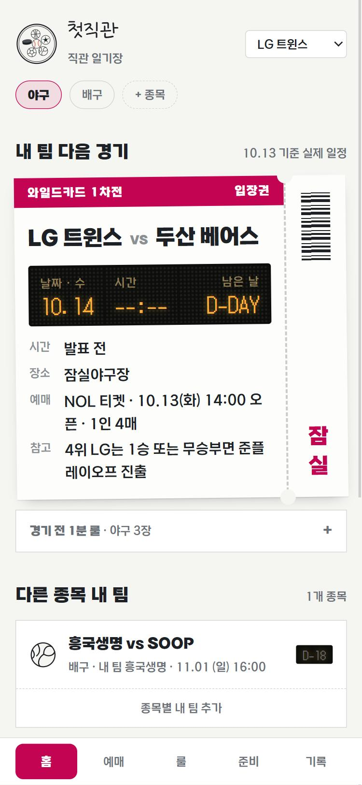
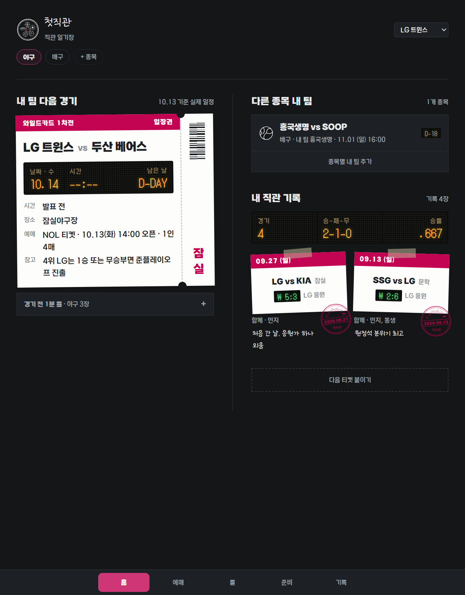
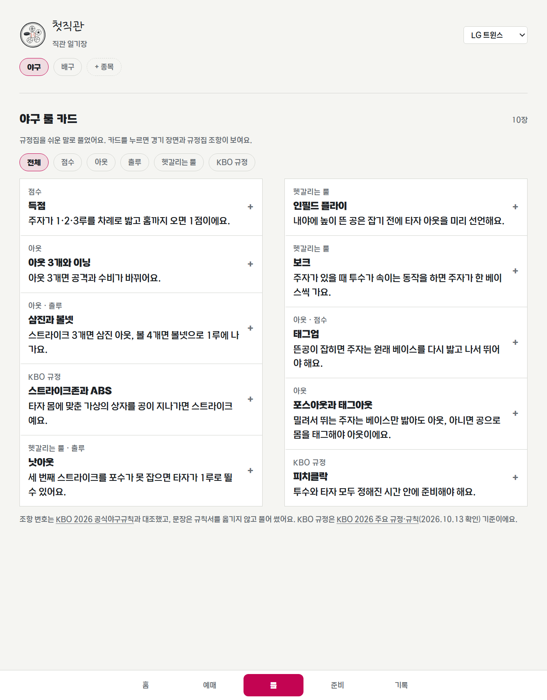
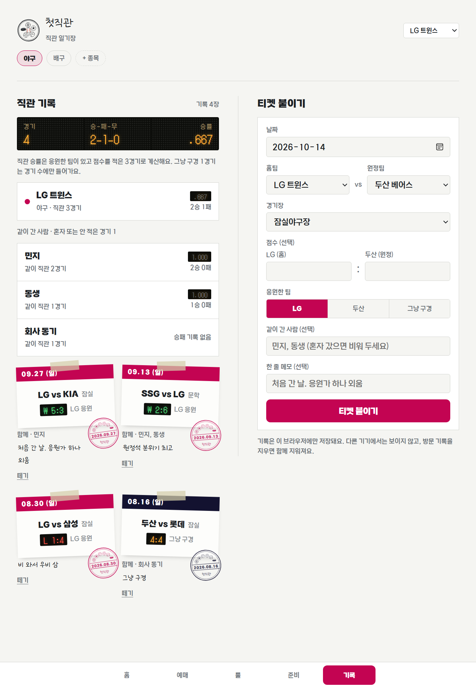
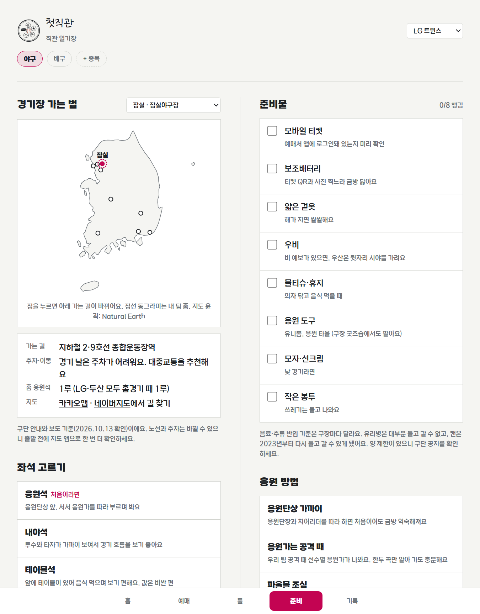

# 첫직관

> 슬기로운 직관생활 — 처음 가는 경기장, 예매부터 응원까지

경기장에 처음 가는 사람을 위한 직관 가이드 웹앱입니다. 내 팀을 고르면 다음 경기, 예매처, 꼭 알아야 할 룰, 경기장 가는 길과 준비물을 한곳에서 보고, 다녀온 경기는 티켓처럼 붙여 직관 승률까지 모읍니다. 지금은 **야구(KBO), 배구(V-리그), 축구(K리그1), 농구(KBL·WKBL), 아이스하키(아시아리그 HL 안양), 핸드볼(H리그)**가 들어 있습니다.

- **사이트: https://yeonland.github.io/first-gikgwan/**
- 로고 시안: [drafts/logo.html](https://yeonland.github.io/first-gikgwan/drafts/logo.html) · 첫 홈 화면 시안: [drafts/first-jikgwan.html](https://yeonland.github.io/first-gikgwan/drafts/first-jikgwan.html)
- 빌드 과정 없이 `index.html`을 브라우저에서 열면 됩니다

| 휴대폰 · 홈 | 태블릿 · 다크 모드 |
|---|---|
|  |  |

---

## 한눈에 보기

하단 메뉴 다섯 칸이 경기장에 가는 순서와 같습니다: **홈 → 예매 → 룰 → 준비 → 기록**

| 탭 | 하는 일 |
|---|---|
| 홈 | 내 팀의 다음 경기를 티켓 한 장으로. 전광판 숫자(날짜·시간·D-day), 이번 주 일정(월~일, 고른 종목 내 팀 경기), 다른 종목 내 팀의 다음 경기, 내 직관 성적 |
| 예매 | 지금 예매할 수 있는 경기, 처음 예매하는 순서 6단계, 구단별 예매처(구단 페이지로 바로 연결) |
| 룰 | 맨 위에 이 종목 한눈에(선수 수·경기 시간·이기는 법), 종목마다 룰 카드 10장. 쉬운 말 한 줄 → 경기에서 보면 → 규정집 조항. 헷갈리는 룰은 공식 채널 영상으로 |
| 준비 | 경기장 약도와 가는 길(카카오맵·네이버지도 연결), 홈 응원석 방향, 좌석 고르기, 준비물 체크리스트, 응원 방법 |
| 기록 | 다녀온 경기를 티켓으로 붙임. 홈팀·원정팀·응원한 팀·같이 간 사람, 직관 승률과 팀별·사람별 성적 |

| 룰 카드 | 직관 기록 | 경기장 가는 법 |
|---|---|---|
|  |  |  |

## 왜 만들었나

경기 일정과 결과는 포털에서 이미 잘 보여 줍니다. 하지만 **처음 가는 사람**에게 필요한 정보는 흩어져 있습니다.

- 예매처와 오픈 시각이 구단마다 다르다
- 어느 쪽이 홈 응원석인지, 처음이면 어디가 좋은지 알기 어렵다
- 낫아웃, 인필드 플라이처럼 경기 중에 헷갈리는 룰을 바로 찾기 어렵다
- 다녀온 경기를 남겨 둘 곳이 마땅치 않다

그래서 첫직관은 **결과를 보여 주는 앱이 아니라, 경기장에 가는 과정을 도와주는 앱**으로 정했습니다.

**누구를 위한가**: 친구나 연인을 따라 처음 경기장에 가는 사람, 팀은 정했지만 룰과 응원 문화가 낯선 신규 팬, 직관 기록을 모으고 싶은 라이트 팬

## 만들면서 정한 것

### 1. 콘셉트: 직관 일기장
종이 티켓을 모으는 스크랩북을 화면의 주인공으로 삼았습니다. 감열지 티켓(팀 색 띠, 절취선, 바코드), 날짜 소인, 숫자만 도트로 빛나는 전광판. 글꼴은 손글씨·본문·전광판 3종, 글자 크기는 5단계로만 씁니다. 자세한 기준은 [DESIGN.md](DESIGN.md).

### 2. 내 팀 색으로 바뀌는 화면, 읽히는 건 그대로
팀을 고르면 강조색 전체가 그 팀 색으로 바뀝니다. 다만 남색·검정 같은 팀 색은 다크 모드에서 안 보이고, 노랑·주황 위의 흰 글씨는 읽히지 않습니다.
- 바탕과 **대비 3:1 이상**인 색을 자동으로 고릅니다 (메인 → 살짝 조정 → 서브 → 더 조정 순서)
- 팀 색 버튼·띠 위 글자는 흰색과 검정 중 더 잘 보이는 쪽을 자동으로 고릅니다 (KB손해보험 노랑, 한화 주황은 검정 글씨)

### 3. 정확하게, 그리고 남의 것은 빌리지 않게
- 룰 카드의 조항 번호는 종목마다 공식 규칙서(야구 KBO 2026, 배구 대한배구협회 2025~2028, 축구 IFAB 2026/27, 농구 FIBA 2026, 아이스하키 IIHF 2025/26)와 하나씩 대조했습니다. 문장은 규칙서를 옮기지 않고 모두 풀어 썼습니다 (규칙서 목록은 아래 출처)
- 일정·예매처·교통처럼 바뀌는 정보에는 **확인 날짜**를 붙이고, 확인하지 못한 건 지어내지 않고 "지도 앱으로 확인" 같은 안내로 남겼습니다
- 영상은 **공식 방송사·구단·협회 채널**에서 퍼가기가 허용된 것만 넣었습니다. 중계 화면을 잘라 만든 GIF나 개인 채널 영상은 쓰지 않습니다
- 응원가는 앱에 넣지 않고 구단 공식 홈페이지로 연결합니다

### 4. 처음 온 사람의 눈높이
- 경기장·중계에서 쓰는 말은 그대로 두고 괄호로 뜻을 붙입니다: 무사(아웃 0개), 만루(1·2·3루에 모두 주자), 리시브(서브·공격 받기)
- 티켓과 전광판의 이름표도 한글로 씁니다 (와일드카드 1차전, 입장권, 승-패-무). 전광판 안의 값만 글꼴 때문에 숫자·기호로 남겼습니다
- 홈 응원석 방향을 구장마다 적었습니다. 야구는 라팍·챔필만 3루가 홈이라 "대부분의 구장과 반대"라고 알려 줍니다

### 5. 직관 기록: 내 팀 경기만 가는 건 아니니까
- 홈팀·원정팀을 따로 고르고, 응원한 팀(홈 / 원정 / 그냥 구경)을 고릅니다
- **직관 승률**은 응원한 팀이 있고 점수를 적은 경기만 세고, 무승부는 뺍니다 (KBO 승률 계산과 같음). 계산 기준을 화면에 한 줄로 적어 둡니다
- 팀별 직관 승률, 같이 간 사람별 기록("민지 · 같이 직관 2경기")
- 예전 형식으로 저장된 기록은 새 형식으로 자동으로 옮깁니다

### 6. 종목을 늘려도 화면 코드는 그대로
- 화면 코드는 `index.html` 하나를 모든 종목이 같이 쓰고, 종목마다 다른 내용은 `data/<종목>.js`에만 둡니다
- 처음 들어오면 종목을 여러 개 고르고 종목마다 내 팀을 고릅니다. **고른 종목의 데이터만** 불러옵니다
- 새 종목은 데이터 파일 하나를 채우고 목록에서 `ready:true`로 바꾸면 들어갑니다 (방법은 DESIGN.md)

### 7. 가볍게
- 빌드 도구와 라이브러리 없이 HTML·CSS·JS 한 장입니다
- 경기장 지도는 지도 라이브러리 대신 대한민국 윤곽을 SVG 약도로 그렸습니다 (약 3KB, Natural Earth 퍼블릭 도메인 데이터를 직접 변환)
- 영상은 썸네일만 먼저 보여 주고 누를 때 불러옵니다. 룰 카드는 한 번에 하나만 펼치고, 닫으면 영상도 멈춥니다
- 휴대폰 한 쪽 / 태블릿 펼친 일기장 두 쪽 / PC 왼쪽 세로 메뉴, 라이트·다크 모드

## 파일 구성

```
first-gikgwan/
├─ index.html       앱 화면 (모든 종목이 같이 쓰는 화면 코드)
├─ data/
│  ├─ baseball.js   야구: 10개 구단, 2026 포스트시즌, 예매처, 룰 카드, 구장
│  ├─ volleyball.js 배구: 남녀 14팀, 2026-27 개막 일정, 룰 카드, 체육관
│  ├─ soccer.js     축구: K리그1 12팀, 2026 정규 라운드 남은 경기, 룰 카드, 경기장
│  ├─ basketball.js 농구: KBL 10팀·WKBL 6팀, 2026-27 정규리그 일정, 룰 카드, 체육관
│  ├─ hockey.js     아이스하키: 아시아리그 6팀, HL 안양 2026-27 일정, 룰 카드, 안양빙상장
│  └─ handball.js   핸드볼: H리그 남녀 14팀, 26-27 일정 발표 전, 룰 카드, 경기장 7곳
├─ DESIGN.md        디자인 기준 (색, 글꼴, 글자 크기, 화면별 규칙)
├─ docs/screens/    README 화면 캡처
├─ drafts/          로고 시안, 첫 홈 화면 시안
└─ fonts/           KBO 다이아고딕 (woff)
```

- 저장: 내 팀·직관 기록·준비물 체크는 그 브라우저의 localStorage에만 저장됩니다. 서버와 로그인은 없습니다
- 강원교육새음 글꼴과 규칙서 PDF(`rule/`)는 재배포 금지·저작권 때문에 저장소에 넣지 않았습니다

## 진행 상황
- [x] 콘셉트·이름·로고(꽃 도장 + 날짜 소인)·디자인 기준
- [x] 홈 / 예매 / 룰 / 준비 / 기록 다섯 탭
- [x] 야구 KBO: 10개 구단, 2026 포스트시즌 실제 일정, 구단별 예매처, 룰 카드 10장, 9개 구장
- [x] 배구 V-리그: 남녀 14팀, 2026-27 첫 경기·첫 홈경기, 룰 카드 10장, 11개 체육관
- [x] 축구 K리그1: 12팀, 2026 정규 라운드 남은 경기(32·33라운드), K리그 일정·예매 연결, 룰 카드 10장(IFAB 경기규칙 2026/27 대조), 12개 경기장
- [x] 농구 KBL·WKBL: 남녀 16팀, 2026-27 정규리그 일정(KBL 10.14~11.08, WKBL 개막~11.20), 구단 예매 페이지 연결, 룰 카드 12장(FIBA 경기규칙 2026·KBL 규약·KBL·WKBL 경기규칙 대조, 두 리그가 다른 점 카드 포함), 14개 체육관
- [x] 아이스하키 아시아리그: 6팀(국내는 HL 안양), HL 안양 2026-27 남은 경기, 티켓링크 연결·좌석 가격, 룰 카드 10장(IIHF 규정집 2025/26·아시아리그 개최요강 대조), 안양빙상장
- [x] 룰 탭 맨 위 이 종목 한눈에 (선수 수·경기 시간·이기는 법)
- [x] 종목 구조: 데이터 분리, 처음 설정(여러 종목 + 종목마다 내 팀), 종목 칩
- [x] 룰 카드 영상 7장 (공식 방송사 채널), 그림 샘플 2장
- [x] 직관 기록: 홈·원정·응원한 팀·같이 간 사람, 직관 승률·팀별·사람별 기록
- [x] 경기장 지도 (일기장 약도 + 카카오맵·네이버지도)
- [x] 반응형, 라이트·다크 모드, GitHub Pages 배포

### 나중에 할 일
- [x] 핸드볼 H리그: 남녀 14팀, 26-27 일정은 발표 전이라 "일정 발표 전"으로 표시, 티켓링크 연결, 룰 카드 10장(IHF 경기규칙 2025·2025 변경 규칙 대조), 경기장 7곳
- [ ] 핸드볼 26-27 일정 나오면 넣기
- [ ] 룰 카드 그림 13장 (영상보다 그림이 나은 카드. 그림 스타일을 정한 뒤)
- [ ] 구장 먹거리 (구장 안 대표 메뉴, 시즌 기준일을 붙여서)
- [ ] 직관 기록 백업: 파일로 내보내기·불러오기 → 로그인·서버로 기기 간 동기화
- [ ] 응원가·하이라이트 영상, 직관 사진 갤러리
- [ ] 배구·축구·농구 팀 색을 Figma 색 스타일로 정리 (지금은 구단 BI를 보고 고른 임시 색)

## 다루려는 종목
홈팀, 경기장, 시즌이 있는 국내 리그만 다룹니다. 어느 달이든 두 리그 이상이 열려서 1년 내내 "다음 직관"이 있습니다.

| 종목 | 리그 | 시즌 | 상태 |
|---|---|---|---|
| 야구 | KBO (10팀) | 3월 ~ 10월, 포스트시즌 11월 초 | 들어 있음 |
| 배구 | V-리그 (남녀 각 7팀) | 10월 말 ~ 이듬해 4월 | 들어 있음 |
| 남자농구 | KBL (10팀) | 10월 ~ 이듬해 4월 | 들어 있음 |
| 여자농구 | WKBL (6팀) | 11월 ~ 이듬해 3월 | 들어 있음 |
| 핸드볼 | H리그 (남 6팀, 여 8팀) | 11월 ~ 이듬해 5월 초 | 들어 있음 |
| 아이스하키 | 아시아리그 (국내 HL 안양) | 9월 ~ 이듬해 3월, 플레이오프 3월 | 들어 있음 |
| 축구 | K리그1 (12팀) | 2월 말 ~ 12월 초 (파이널 라운드) | 들어 있음 |

검토 후 제외: 골프(홈팀·고정 경기장이 없음), 당구(대부분 중계로 관람), e스포츠(운동 경기가 아님)

## 출처

### 규칙서
룰 카드의 조항 번호는 아래 규칙서와 하나씩 대조했고, 카드 문장은 규칙서를 옮기지 않고 풀어 썼습니다. 규칙서 PDF는 저작권 때문에 저장소에 넣지 않고 로컬 `rule/` 폴더에만 둡니다.

| 종목 | 규칙서 | 받은 곳 |
|---|---|---|
| 야구 | KBO 2026 공식야구규칙 | [한국야구소프트볼심판아카데미 야구규칙서 게시판](http://www.umpire.or.kr/?act=board&bbs_code=sub5_5) ([KBO 파일](https://6ptotvmi5753.edge.naverncp.com/KBO_FILE/ebook/pdf/2026_%EC%95%BC%EA%B5%AC%EA%B7%9C%EC%B9%99.pdf)) |
| 배구 | 배구경기규칙서 2025~2028 (FIVB) | [대한배구협회](https://www.kva.or.kr/user/template.do?fileNm=vlb2_1) |
| 축구 | IFAB 축구 경기규칙 2026/27 (한국어판) | [서울특별시축구협회 경기규칙](http://seoulfa.or.kr/bbs/board.php?bo_table=rule&wr_id=5) |
| 농구 | FIBA 공식 농구 경기규칙 2026 (한국어판) | [대한민국농구협회 경기규칙](https://www.koreabasketball.or.kr/basketball/game_rule.php) |
| 농구 리그 규정 | KBL 2026-2027 경기규칙서 (FIBA 바탕, 작전타임·챌린지 등 일부 다름) | [KBL](https://kbl.or.kr) |
| 농구 리그 규정 | KBL 규약 (2025.08.28 개정) | [KBL 규정](https://kbl.or.kr/rule/regulation) |
| 농구 리그 규정 | WKBL 2025-2026 경기 규칙 (FIBA 바탕, 명단·타임아웃·챌린지 등 일부 다름) | [WKBL 경기규칙](https://www.wkbl.or.kr/about/game_rule.asp) |
| 핸드볼 | IHF Rules of the Game for Indoor Handball (2025.07.01, 영문) | [국제핸드볼연맹](https://www.ihf.info) |
| 핸드볼 | 2025 변경 규칙 (위 규칙의 바뀐 부분 한국어 번역) | [한국핸드볼연맹 경기규칙](https://www.koreahandball.com/hkl/game_rule.php) |
| 아이스하키 | IIHF 공식 규정집 2025/26 (영문) | [IIHF 규정집](https://www.iihf.com/en/statichub/4719/rules-and-regulations) |
| 아이스하키 리그 규정 | 아시아리그 2026-27 개최요강 (연장·승부치기·승점) | [아시아리그 개최요강](https://asiaicehockey.com/outline) |

리그만의 규칙(승점, 연장, ABS·피치클락, 파이널 라운드 등)은 각 리그의 대회요강·공식 발표로 따로 확인했습니다.

### 그 밖에
- 경기 일정은 화면에 적힌 기준일의 실제 일정입니다. 기록이 없을 때 홈에 보이는 티켓 2장은 예시입니다.
- 야구 구단 컬러는 Figma에 정리한 색 스타일(구단별 메인·서브)을 따릅니다.
- 룰 카드 영상은 각 방송사·구단의 공식 유튜브 채널 영상을 유튜브 플레이어로 재생합니다. 영상의 권리는 각 채널에 있습니다.
- 야구 KBO 규정(ABS, 피치클락, 연장)은 [KBO 2026 주요 규정·규칙](https://www.koreabaseball.com/Kbo/League/GameManage2026.aspx) 기준입니다.
- V-리그 일정·예매처는 [KOVO](https://kovo.co.kr) 기준(2026.10.13 확인)입니다.
- K리그 승점·파이널 라운드와 일정은 [K리그](https://www.kleague.com) 대회요강·일정표 기준(2026.10.14 확인)입니다.
- H리그 팀·경기장은 [한국핸드볼연맹](https://www.koreahandball.com) 팀 소개·경기장 소개 기준(2026.10.14 확인)입니다. 26-27 일정은 아직 발표 전입니다.
- HL 안양 일정·티켓 가격은 [HL 안양 홈페이지](http://www.hlicehockey.com) 기준(2026.10.14 확인)입니다.
- KBL·WKBL 일정은 네이버 스포츠 일정, 예매처는 KBL·WKBL 홈페이지와 구단 티켓 안내 기준(2026.10.14 확인)입니다.
- 구장 지도의 윤곽은 [Natural Earth](https://www.naturalearthdata.com/)(퍼블릭 도메인), 구장 좌표는 © [OpenStreetMap](https://www.openstreetmap.org/copyright) 기여자 기준입니다.
- 이 프로젝트는 KBO 및 각 구단과 관계없는 개인 프로젝트입니다.

## 글꼴 라이선스: KBO 다이아고딕
지적 재산권은 (사)한국야구위원회에 있습니다. 출처: [KBO 다이아고딕 라이선스 안내 Ver.2 (2023)](https://6ptotvmi5753.edge.naverncp.com/KBO_FILE/file_down/KBO_%EB%8B%A4%EC%9D%B4%EC%95%84%EA%B3%A0%EB%94%95_%EB%9D%BC%EC%9D%B4%EC%84%A0%EC%8A%A4_%EC%95%88%EB%82%B4_Ver2.pdf)

| 항목 | 내용 | 이 프로젝트 |
|---|---|---|
| 웹, 모바일 웹, 앱 제작·운영 | 가능 | 본문, 티켓에 사용 |
| 웹·서버에 폰트 파일 탑재(임베딩) | 가능 | `fonts/`에 woff 원본 탑재 |
| 상업적 이용 | 가능 (개인·기업 무료) | |
| **CI/BI** (사명, 브랜드명, 상품명, 로고, 슬로건) | **불가** | "첫직관" 로고는 강원교육새음 사용 |
| 글꼴 수정·개작 후 재배포, 글꼴 유료 판매 | 불가 | 받은 파일 그대로 사용 |
| 불법 사이트, 허위·과장 광고 등에 사용 | 불가 | |

- 출처 표기 의무는 없습니다.
- 이 글꼴로 만든 결과물의 이미지는 KBO 프로모션에 쓰일 수 있고, 원하지 않으면 요청할 수 있습니다.
- 사용 범위가 불분명하면 (주)KBOP에 문의합니다.

## 글꼴 라이선스: 강원교육새음 (로고, 손글씨 메모)
강원교육서체 · 강원도교육청. 출처: [눈누](https://noonnu.cc)

- 누구나 무료로 쓸 수 있고, 로고(CI/BI)를 포함해 웹·모바일·인쇄·영상에 별도 허가 없이 사용할 수 있습니다. 출처 표기는 권장 사항입니다.
- 글꼴 파일의 수정, 복제, 배포, 유료 판매는 금지입니다. 그래서 파일은 저장소에 넣지 않고 CDN으로 불러옵니다.

## 글꼴 라이선스: DotGothic16 (전광판 숫자)
Google Fonts, SIL Open Font License.
